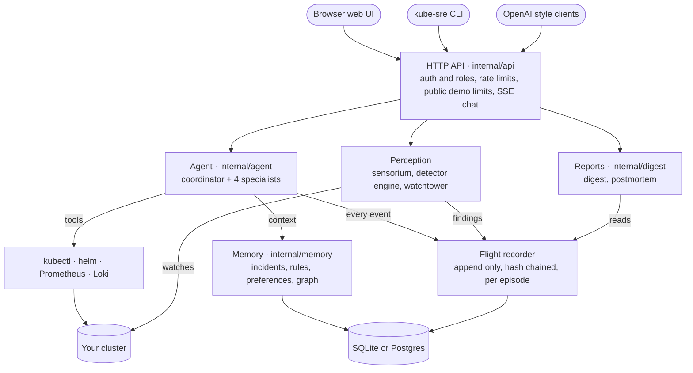
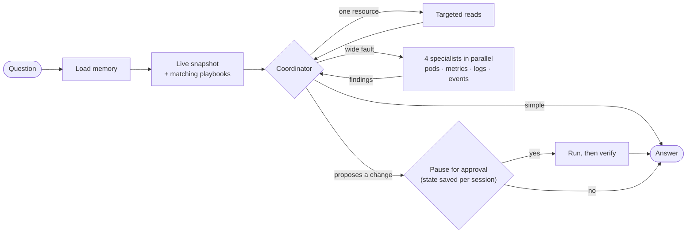
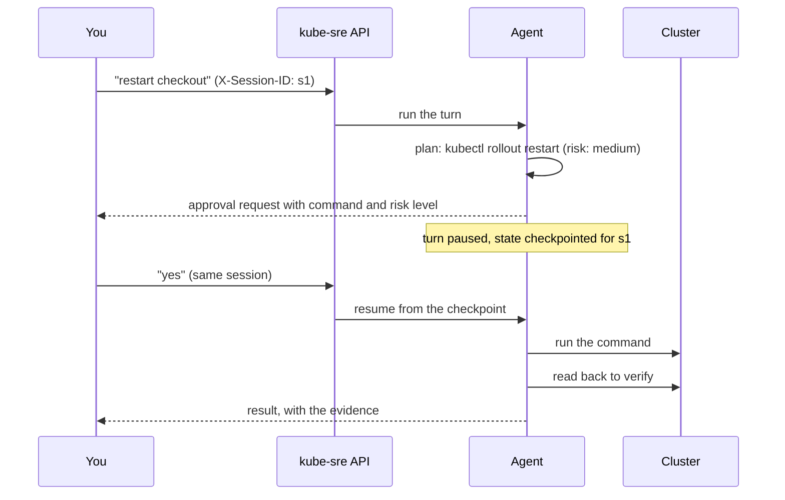
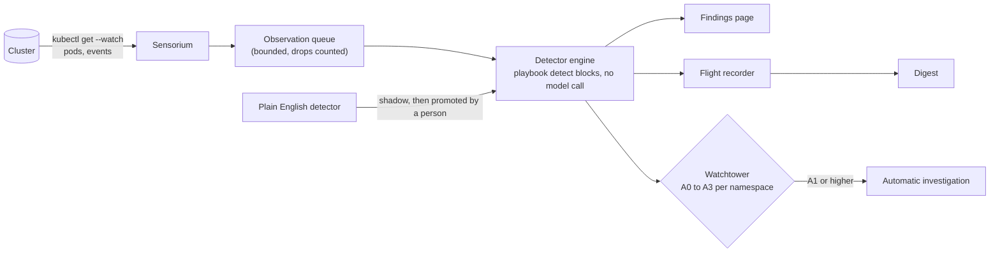
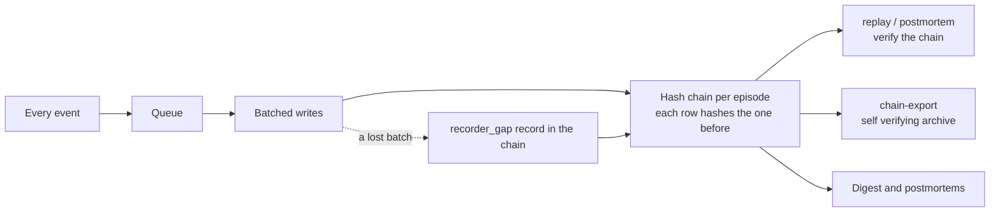

# kube-sre architecture

How kube-sre works inside: what happens to a question, how it watches a cluster, what it
remembers and how it keeps a record you can check. For the hosted demo, see
[DEMO.md](DEMO.md).

## The big picture

kube-sre is one Go binary (`cmd/kube-sre`). Run as `kube-sre serve`, it is an HTTP server with
the web UI built in; the same binary is also the command line client and the admin tools.

## What happens to a question

1. **The request.** `POST /v1/chat/completions` (OpenAI compatible, always streaming). The API
   works out who is asking (an API key, an admin sign in cookie, or, in a public demo, a
   visitor), applies rate limits and for public visitors the hourly limit, the concurrency cap
   and the daily budget.
2. **Memory.** The agent loads what it knows that is relevant: your preferences, matching past
   incidents and learned rules and recent changes from the knowledge graph, kept within about
   500 tokens. Anything that could not be read is named, so a failed read never looks empty.
3. **A live snapshot.** It reads pods and events straight from the cluster and matches the
   result against the 27 playbooks so the matching ones' steps and expected evidence go into
   the prompt.
4. **The coordinator decides how deep to go:**
   - answer directly from the snapshot and its tools;
   - dig into one named resource (a targeted investigation);
   - or fan out to four specialists (pods, metrics, logs, events), each running its own tool
     loop and returning a structured finding, then synthesise their findings into one answer.

   A step budget (`AGENT_GRAPH_RECURSION_LIMIT`) stops a turn that keeps reopening and each
   specialist has its own budget.
5. **Streaming back.** Tokens, tool calls, plans and token usage stream to the client as Server
   Sent Events and every event is written to the flight recorder.
6. **Approvals.** If the answer proposes a change, the turn pauses. Its state is saved per
   session (`X-Session-ID`), the client shows the command with its risk level and a `yes` or
   `no` in the same session resumes it.

An approval, step by step:

## Tools and how they are kept safe

The model has four tools: `run_kubectl`, `run_helm` (read only), `query_prometheus` and
`query_loki`. Everything that touches the cluster goes through `run_kubectl`
(`internal/kube`), which applies its layers in order:

1. shell metacharacters are refused (there is no shell; commands are parsed and run directly);
2. YAML passed on stdin is validated before the cluster is touched;
3. connection and identity flags (`--server`, `--as`, `--kubeconfig`, ...) are refused, so the
   deployment alone decides which cluster and as whom;
4. rejected verbs, then the caller's role (`readonly`, `operator`, `admin`, `superadmin`);
5. protected namespaces and resource types, read from the arguments and the manifest; secrets
   and service accounts are never readable;
6. risk classification: unknown verbs count as writes, writes need approval and some
   (deleting a namespace, a PV or a CRD, draining a node, changing an image or resources) ask
   even when approvals are automatic;
7. execution with `| grep` emulated in Go, protected namespaces filtered out of the output
   with a note saying so, secrets redacted and an output cap.

`internal/aci` adds bounded, normalised read verbs and a single chokepoint for mutations on
top of the same path, so they inherit every layer above.

## Acting on its own: autonomy levels

The watchtower (`internal/autonomy`) decides what happens when a detector fires, per
namespace:

| Level | What it does |
|---|---|
| A0 observe | the finding is logged; no model call |
| A1 investigate | an automatic investigation runs and its report is published; no changes |
| A2 propose | the investigation may propose a fix; running it still needs approval |
| A3 auto fix | runs without approval, only for allow listed (playbook, namespace) pairs and is always verified afterwards |

Protected namespaces are pinned to A0 and objects without a namespace (nodes, volumes) are
capped at A1. Every automatic change also sits behind a kill switch, a change freeze and a
spend cap and a poor track record revokes auto fix rights on its own. The watchtower is on by
default (`WATCHTOWER_ENABLED`); the public demo turns it off, so visitors only see findings.

## Watching the cluster

- **The sensorium** (`internal/sensorium`) keeps two `kubectl get --watch` streams open, pods
  and events and turns each change into an observation on a bounded queue. If the queue ever
  drops observations, that is counted and reported.
- **The detector engine** (`internal/detect`) evaluates the compiled `detect:` blocks of the
  playbooks against each observation. These cost no model call. A firing becomes a finding: it
  goes into an in memory list (the Findings page) and into the flight recorder (the digest).
- **Perception** (`internal/perception`) answers one question for every screen: is anything
  actually watching? The digest and the Findings page both ask it, so a quiet report is only
  ever shown when the watch was really running.
- **Plain English detectors** (`internal/detectstore`): a description is compiled into a
  detector that starts in shadow mode, records what it would have fired and becomes active
  only when a person promotes it.

## Memory

`internal/memory` keeps, per cluster (`CLUSTER_ID`):

- **episodes:** each investigation, its root cause, what was tried and what worked;
- **preferences:** what you told it, plus what it inferred from repeated choices;
- **learned rules:** IF-THEN rules promoted from verified, recurring fixes;
- **a temporal knowledge graph:** what runs where and what changed, with event times;
- **prospective re-checks:** after a fix, it reads the cluster again later and records whether
  the fix held.

Background consolidation summarises themes and prunes old telemetry, never the chained
ledgers or episodes. With `MEMORY_SECURITY_HARDENING`, writes that come from users are rate
limited, screened for injection patterns and kept in their own audit chain.

## The record you can check

- **The flight recorder** (`internal/recorder`) appends every event to a hash chain, one chain
  per episode. Writes never block the request: they are queued and batched. A lost batch is
  written into the chain as a gap record, so missing events are visible rather than silent.
- **Verification:** `kube-sre replay` and the postmortem check the chain. A broken link means
  something was changed after it was written.
- **Archives and backups** (`internal/chainops`): export a self verifying archive, verify it
  with no database, deliberately truncate with a declared gap and take or check a backup
  manifest that records how far each chain got.
- **Reports** (`internal/digest`): the digest and postmortems are views over that record and
  the episode store. Neither is a separate history and neither calls the model unless you ask
  for a written narrative.

## Storage

SQLite by default (`~/.kube-sre/kube-sre.db`), or Postgres when `DATABASE_URL` or
`POSTGRES_HOST` is set. `internal/schema` lists every migration in order; `serve` applies them
on start and `/healthz` reports whether the database matches. On Postgres, leader election
(`internal/store`) lets only one replica run the background work (sensorium, watchtower,
consolidation) while every replica serves the API.

## API, sign in and the web UI

- **Roles** come from API keys per role (`KUBESRE_*_KEYS`), expiring HMAC signed demo keys, or
  an admin password sign in at `/admin` (an HttpOnly cookie with a CSRF header on writes and a
  lockout after repeated failures). With no keys at all, every caller is admin, for local use.
- **Public demo mode** (`PUBLIC_DEMO`) gives visitors without a key a read only `public` role
  that can only reach chat, findings, the digest and postmortems, with per visitor limits, a
  shared daily budget and an optional Cloudflare Turnstile check.
- **The web UI** (`ui/`, React with [React Bits](https://reactbits.dev) components) is built
  into `internal/web/static` and embedded in the binary. It is served under a strict Content
  Security Policy that allows only its own scripts and styles.
- **Health:** `/healthz` reports the recorder, audit, memory, sensorium, leader and schema
  state; `/v1/v5/status` adds the experimental features and the write brakes.

## Where things live

| Package | Role |
|---|---|
| `cmd/kube-sre` | the binary: `serve`, the CLI client and admin commands |
| `internal/app` | wires everything together and owns start up and shut down order |
| `internal/api`, `internal/web` | HTTP API, auth, public demo, embedded UI |
| `internal/agent`, `internal/llm` | the coordinator and specialists, the model client |
| `internal/kube`, `helm`, `prom`, `loki`, `aci`, `nsguard`, `redact`, `policy` | tools and their guards |
| `internal/playbooks` | the 27 playbooks (YAML, with optional `detect:` blocks) |
| `internal/sensorium`, `detect`, `perception`, `detectstore` | watching and detecting |
| `internal/autonomy`, `change`, `cortex` | autonomy levels and brakes, the change ledger, opt in investigation features |
| `internal/memory` | long term memory |
| `internal/recorder`, `audit`, `chainops`, `events`, `spans` | the record, its export, the event protocol, OpenTelemetry spans |
| `internal/digest` | the digest and postmortems |
| `internal/store`, `schema` | SQLite or Postgres, migrations, leader election |
| `internal/config`, `cluster`, `setup`, `provenance`, `client`, `fleet`, `eval`, `metrics`, `logging` | settings, cluster identity, local setup, release verification, CLI client, cross cluster learning, evaluation, metrics, logs |
