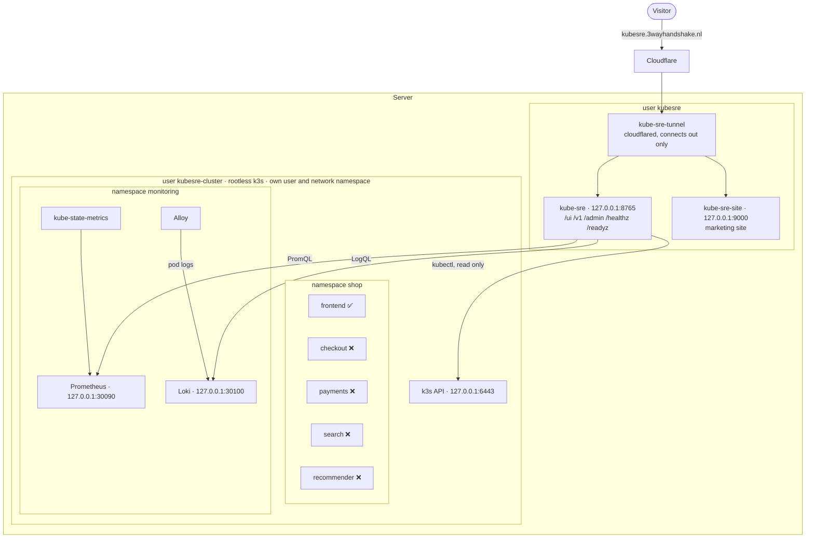
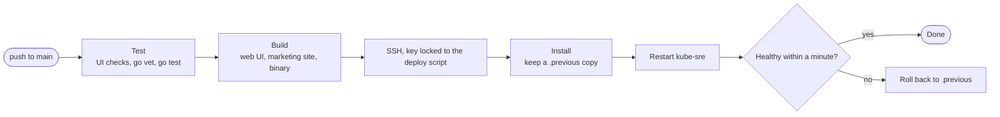

# The live demo

The [live demo](https://kubesre.3wayhandshake.nl/ui/) runs kube-sre against a small Kubernetes
cluster built to have problems. This page covers what is in that cluster, how the demo is
hosted, how to build the same thing yourself, and how the hosted one is deployed and looked
after. For how kube-sre itself works, see [ARCHITECTURE.md](ARCHITECTURE.md).

Commands for the hosted server use `<server>` for its SSH address, which is kept out of this
repository.

## What is in the demo cluster

### The shop: one healthy app, four broken on purpose

All in the `shop` namespace, from [`examples/shop.yaml`](examples/shop.yaml). Each broken app
fails in a different, common way, so there is something real to diagnose:

| App | What is wrong | What you see | What kube-sre should find |
|---|---|---|---|
| `frontend` | nothing | Running | a healthy baseline to compare against |
| `checkout` | its command prints `FATAL connection refused` to `db.shop.svc:5432` and exits 1 | `CrashLoopBackOff` | the container exits on start; the database it wants does not exist, so it is checkout's own config |
| `payments` | its image is `registry.example.invalid/payments:v9`, which cannot exist | `ImagePullBackOff` | the image cannot be pulled; the registry name does not resolve |
| `search` | its readiness probe asks port 8080 for `/healthz`, but nginx serves on 80 | `Running` but never `Ready` | the probe targets the wrong port, so the pod never gets traffic |
| `recommender` | a shell loop doubles a string forever, against a 32Mi limit | `OOMKilled`, restarting | it runs out of memory; its usage climbs straight to the limit |

A `ResourceQuota` caps the namespace at 10 pods and 1Gi of memory limits, so the broken apps can
never grow past it.

### Monitoring, in the `monitoring` namespace

| Component | Chart | Settings | Why kube-sre needs it |
|---|---|---|---|
| Prometheus | `prometheus-community/prometheus` 29.31.1 | 24h retention, no disk, no node-exporter, alertmanager or pushgateway | memory and restart history, for questions like "why does recommender keep restarting?" |
| kube-state-metrics | (part of the Prometheus chart) | small limits | pod and container state as metrics |
| Loki | `grafana/loki` 7.3.0 | single binary, 24h retention, 2Gi volume | searching logs across pods and time |
| Alloy | `grafana/alloy` 1.12.1 | reads pod logs through the Kubernetes API | ships every pod's logs into Loki |

Values: [`examples/demo-cluster/`](examples/demo-cluster/). Node-exporter is left out because it
needs access to the host, which a rootless cluster does not have; pod and container metrics do
not need it.

### kube-sre's identity

[`examples/demo-cluster/rbac.yaml`](examples/demo-cluster/rbac.yaml) creates a `kube-sre`
ServiceAccount in `sre-agent`, bound to the built in `view` role plus pod and node metrics and
namespaces. It can list, get and watch. It cannot read secrets, create, delete, patch, or exec
into a pod, so the demo stays read only even if kube-sre's own guards were bypassed.

### Also running

k3s's own `coredns`, `local-path-provisioner` (the volume for Loki) and `metrics-server`
(`kubectl top`). Traefik and servicelb are turned off: nothing in the cluster listens on ports
80 or 443.

## How it is hosted

kube-sre, the marketing site and the demo cluster run on one server, each isolated, with no open
ports.



- **No open ports.** Visitors reach the site and the demo through a Cloudflare Tunnel, which
  connects out from the server. DNS points at the tunnel, not at the server, so moving servers
  never needs a DNS change. The path routes (which go to 8765 and which to 9000) live in the
  tunnel's public hostname settings in Cloudflare.
- **Public demo mode.** Visitors get a read only role with per visitor limits and a shared daily
  budget. Admins sign in at `/admin`.
- **A rootless cluster.** k3s runs as its own unprivileged user, in its own user and network
  namespace, so it adds no network interfaces and no firewall rules to the server. Containers are
  "root" only inside their sandbox. The k3s API listens on port 6443 but the firewall blocks it
  from the internet; Prometheus and Loki are forwarded to `127.0.0.1` only.
- **Capped.** One systemd unit holds the whole cluster, every pod included: 3 GB of memory and
  1.5 CPU cores at most, low CPU and disk priority, and it is stopped first if the server runs
  short of memory. In practice it uses about 1.7 GB, much of it cached image layers, and about 0.7
  of a core, mostly k3s itself plus the crash looping pods.

kube-sre connects with these settings in its `.env`:

| Setting | Value |
|---|---|
| kubeconfig | the `sre-agent/kube-sre` token, for `https://127.0.0.1:6443` |
| `PROMETHEUS_URL` | `http://127.0.0.1:30090` |
| `LOKI_URL` | `http://127.0.0.1:30100` |
| `CLUSTER_ID` | `kube-sre@demo:a64129c2`, pinned so kube-sre's memory stays attached to this demo when the cluster moves |

kube-sre's detectors watch pods and events through that same read only identity, so findings
appear within minutes of a pod failing.

## Build your own

On any cluster you can reach with `kubectl` and `helm` (kind, k3d, k3s, minikube, or a real one):

```bash
kubectl apply -f examples/shop.yaml
kubectl apply -f examples/demo-cluster/rbac.yaml

helm repo add prometheus-community https://prometheus-community.github.io/helm-charts
helm repo add grafana https://grafana.github.io/helm-charts
kubectl create namespace monitoring
helm install prometheus prometheus-community/prometheus --version 29.31.1 -n monitoring -f examples/demo-cluster/prometheus-values.yaml
helm install loki grafana/loki --version 7.3.0 -n monitoring -f examples/demo-cluster/loki-values.yaml
helm install alloy grafana/alloy --version 1.12.1 -n monitoring -f examples/demo-cluster/alloy-values.yaml

# reach them from where kube-sre runs
kubectl -n monitoring port-forward --address 127.0.0.1 svc/prometheus-server 30090:80 &
kubectl -n monitoring port-forward --address 127.0.0.1 svc/loki 30100:3100 &
```

Then point kube-sre at it: `PROMETHEUS_URL=http://127.0.0.1:30090`, `LOKI_URL=http://127.0.0.1:30100`,
and either your own kubeconfig or one for the `kube-sre` ServiceAccount (its token is in the
`sre-agent/kube-sre-token` secret). Loki needs a default StorageClass for its 2Gi volume; kind,
k3d and k3s have one.

Just want something to investigate? `examples/shop.yaml` alone is enough. Without Prometheus and
Loki, kube-sre still diagnoses everything above from `kubectl`, with less history to go on.

## Operating the hosted demo

### The kube-sre user

Everything belongs to the `kubesre` user. Home is `750`; secret folders are `700`, files `600`.

| Path | What |
|---|---|
| `/home/kubesre/bin/` | `kube-sre`, `kubectl` (v1.35.5, matches the cluster), `cloudflared` |
| `/home/kubesre/.kube-sre/.env` | settings and secrets: model API key, admin login hash, public demo limits, the URLs above |
| `/home/kubesre/.kube-sre/kube-sre.db` | SQLite: flight recorder, audit chains, memory, findings history |
| `/home/kubesre/.kube-sre/kube-sre.kubeconfig` | the read only credentials described above |
| `/home/kubesre/.cloudflared/token` | the tunnel token |
| `/home/kubesre/site/` | the built marketing site (`ui/site-dist`) |

Units in `/etc/systemd/system/`: `kube-sre.service`, `kube-sre-site.service`, `kube-sre-tunnel.service`.

Each runs as `kubesre` with:

- `MemoryHigh`/`MemoryMax` of 384M/512M (kube-sre), 64M/128M (site), 128M/256M (tunnel), low
  `CPUWeight`, and a raised `OOMScoreAdjust`, so under pressure kube-sre gives way first.
- other users' home directories, `/root` and database data made inaccessible.
- `ProtectSystem=strict` and `ProtectHome=read-only`: the binaries, the home folder and the
  site are read only. Only kube-sre may write, and only to `.kube-sre/` and `.kube/`.
- `NoNewPrivileges`, an empty capability set, `PrivateTmp`, `PrivateDevices`, the kernel and
  cgroup protections, and `SystemCallFilter=@system-service`.
- Each unit is also blocked from the others' secrets: kube-sre cannot see the tunnel token,
  the site cannot see `.kube-sre/`, `.kube/` or the token, the tunnel cannot see `.kube-sre/`.

The agent's own limits still apply on top: no shell, `kubectl`, read only `helm`, Prometheus and
Loki only. Use a model API key that belongs to kube-sre alone, with a spend limit set at the
provider.

### The cluster user

Rootless k3s belongs to the `kubesre-cluster` user (home `750`, no login shell).

| Path | What |
|---|---|
| `/home/kubesre-cluster/bin/` | `k3s` v1.35.5+k3s1 (with `kubectl`, `crictl`, `ctr` links) and `helm` v3.19.0 |
| `/home/kubesre-cluster/.config/k3s/config.yaml` | Traefik and servicelb disabled, so nothing binds 80/443 |
| `/home/kubesre-cluster/.kube/k3s.yaml` | the admin kubeconfig (stays with this user) |
| `/home/kubesre-cluster/demo/` | the files from `examples/`: the shop, kube-sre's RBAC, and the Helm values |

`kubesre-cluster.service` holds the whole cluster (`Delegate=yes`): `MemoryHigh=2560M`,
`MemoryMax=3G`, `CPUQuota=150%`, `CPUWeight=30`, `IOWeight=30`, `OOMScoreAdjust=600`, and other
users' home directories, `/root` and database data made inaccessible. Two more units,
`kubesre-cluster-pf-prometheus` and `kubesre-cluster-pf-loki`, run the `127.0.0.1` port
forwards, restart on their own if a pod moves, and stop with the cluster.

To work on it, as root on the server:

```bash
K="sudo -u kubesre-cluster -H env KUBECONFIG=/home/kubesre-cluster/.kube/k3s.yaml PATH=/home/kubesre-cluster/bin:/usr/bin:/bin"
$K kubectl get pods -A                                          # what is running
$K kubectl delete -f /home/kubesre-cluster/demo/shop.yaml        # reset the shop...
$K kubectl apply -f /home/kubesre-cluster/demo/shop.yaml         # ...and bring it back
$K helm list -A
systemctl restart kubesre-cluster                               # restart the whole cluster
```

The cluster is disposable: everything in it can be rebuilt from `examples/`.

### What the cluster needed from the server

These are the only server wide changes, each small and easy to undo:

| Change | Why | Undo |
|---|---|---|
| packages `uidmap`, `slirp4netns` | user namespaces and the cluster's private network | `apt-get remove uidmap slirp4netns` |
| `/etc/apparmor.d/kubesre-cluster` | lets only binaries under `/home/kubesre-cluster/{bin,.rancher}` create user namespaces; Ubuntu blocks that for everything else | `apparmor_parser -R kubesre-cluster && rm /etc/apparmor.d/kubesre-cluster` |
| `/etc/sysctl.d/90-kubesre-cluster.conf` | `net.ipv4.ip_forward = 1`; k3s refuses to start without it. The firewall keeps routed traffic denied, so nothing is forwarded | remove the file, `sysctl -w net.ipv4.ip_forward=0` |

To remove the cluster completely: stop and disable the three `kubesre-cluster*` units, delete
their unit files, `userdel -r kubesre-cluster`, then undo the three changes above.

### Deploying a new version

A push to `main` that touches `cmd/`, `internal/`, `ui/`, `go.mod` or `go.sum` deploys on its
own (`.github/workflows/deploy.yml`, or run it by hand from the Actions tab). The workflow runs
the UI checks and `go test ./...`, builds the web UI (embedded in the binary), the marketing site
and the binary, then pipes one tarball over SSH to the server.



On the server, the CD key in `/home/kubesre/.ssh/authorized_keys` is locked with
`restrict,command="/home/kubesre/deploy/deploy.sh"`: it can do nothing but hand over a release.
That script (`deploy/remote-deploy.sh` in this repo, installed root owned so kubesre can run it
but not change it) takes the server's deploy lock, installs the binary and the site, stops
kube-sre so systemd restarts it (`Restart=always`, so no sudo rule is needed), and rolls back if
it is not healthy within a minute.

GitHub settings: secrets `DEPLOY_SSH_KEY` (the private key) and `DEPLOY_KNOWN_HOSTS` (the
server's pinned host key), variables `DEPLOY_HOST` and `DEPLOY_USER=kubesre`. No GitHub deploy
key is needed, because the server never pulls from GitHub.

After changing `deploy/remote-deploy.sh`, install it again by hand:

```bash
sed 's/\r$//' deploy/remote-deploy.sh | ssh root@<server> 'install -o root -g kubesre -m 750 /dev/stdin /home/kubesre/deploy/deploy.sh'
```

**By hand.** Prefer re-running the workflow from the Actions tab. The server has neither Go nor
Docker, and should not get them, so a manual build happens on any machine with Go 1.27, then
streams across:

```bash
# 1. build (anywhere with Go, from the pushed commit)
CGO_ENABLED=0 go build -trimpath -o kube-sre ./cmd/kube-sre

# 2. install with a backup, under the deploy lock, and restart only kube-sre
cat kube-sre | ssh root@<server> 'flock /var/lock/droplet-deploy.lock sh -c "
  cp -a /home/kubesre/bin/kube-sre /home/kubesre/bin/kube-sre.previous &&
  install -o kubesre -g kubesre -m 750 /dev/stdin /home/kubesre/bin/kube-sre.new &&
  mv -f /home/kubesre/bin/kube-sre.new /home/kubesre/bin/kube-sre &&
  systemctl restart kube-sre"'

# 3. check
ssh root@<server> 'curl -s 127.0.0.1:8765/healthz | head -c 200; curl -s 127.0.0.1:8765/v1/auth/whoami'
```

To roll back: `install -m 750 /home/kubesre/bin/kube-sre.previous /home/kubesre/bin/kube-sre && systemctl restart kube-sre`.

The marketing site deploys the same way: `cd ui && npm run build:site`, then copy `ui/site-dist/`
into `/home/kubesre/site/` (owner `kubesre`). It is served as files, so no restart is needed.

Restarting kube-sre clears the in memory Findings list (it refills as detectors fire). The
digest reads the database and is not affected.

### Checking after any change

```bash
ssh root@<server> 'systemctl is-active kubesre-cluster kube-sre kube-sre-site kube-sre-tunnel
  curl -s -o /dev/null -w "demo %{http_code}\n" https://kubesre.3wayhandshake.nl/healthz
  echo "cluster memory: $(( $(cat /sys/fs/cgroup/system.slice/kubesre-cluster.service/memory.current)/1048576 ))M"'
```

### Moving to another server

Copy `/home/kubesre/` (with an SQLite online backup of the database, never a plain copy of a
running one), recreate the three units, start the new tunnel, then stop the old one. Both
tunnels can run at once for a moment; Cloudflare splits traffic between them. Rebuild the demo
cluster from `examples/` as in [Build your own](#build-your-own), mint a new kubeconfig for the
`sre-agent/kube-sre` ServiceAccount, and keep `CLUSTER_ID` pinned.

### Notes

- `METRICS_ENABLED=false` in `.env`: nothing scrapes kube-sre, and the tunnel's path rule in
  Cloudflare still routes `/metrics`, which made it public. It now answers 404. Remove `metrics`
  from that rule too if you ever turn it back on.
- To replace the model API key without it ever appearing on screen, run this in your own terminal:

  ```bash
  ssh -t root@<server> 'read -rsp "New API key: " K; echo; sed -i "s|^OPENAI_API_KEY=.*|OPENAI_API_KEY=$K|" /home/kubesre/.kube-sre/.env && systemctl restart kube-sre && echo done'
  ```
